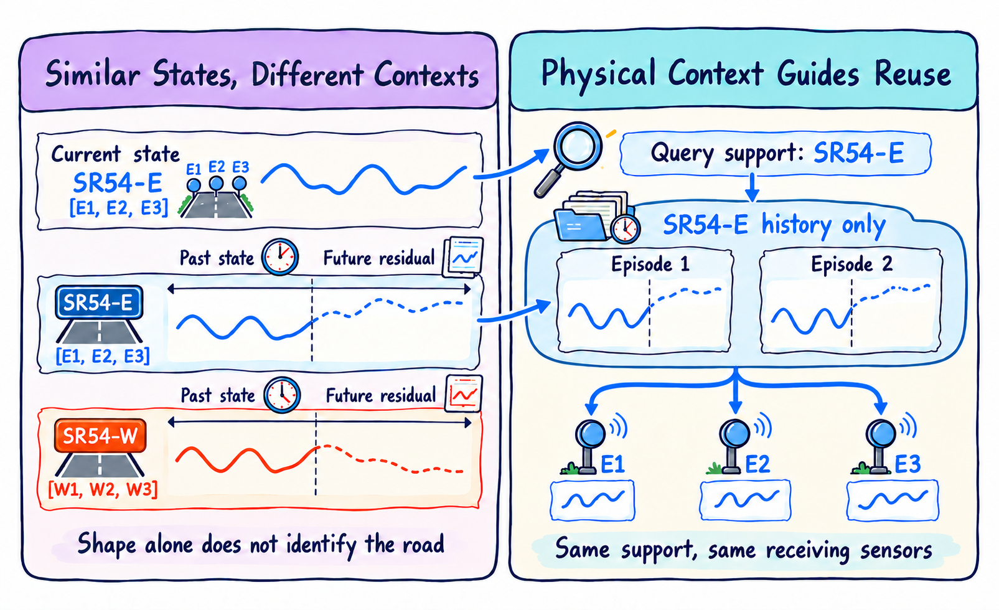
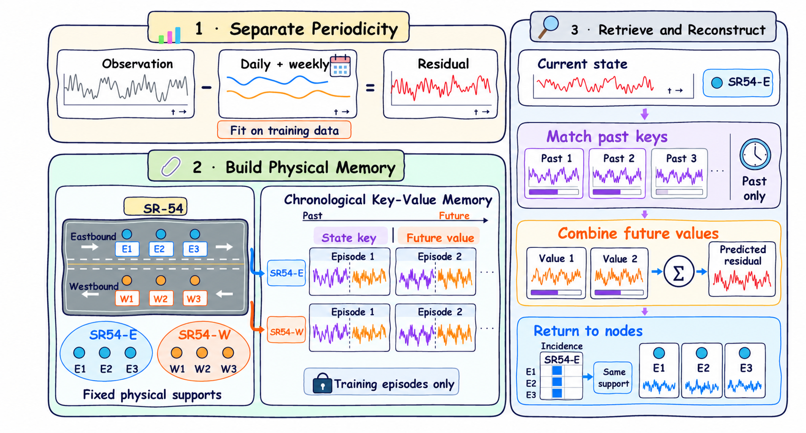
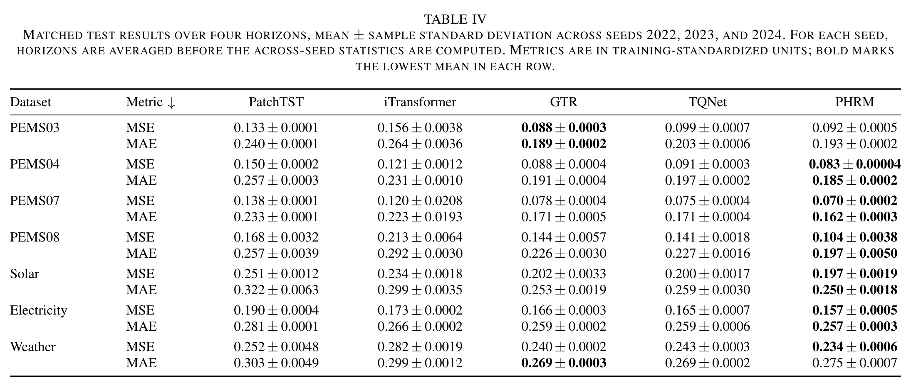

# PHRM: Physical Hypergraph Residual Memory for Time Series Forecasting

This repository contains the research code for PHRM, a residual-memory correction method for time-series forecasting. It also provides an executable reference run for the paired TQNet baseline and PHRM on PEMS08.

## Paper figures

The figures below are taken from the supplied paper PDF. The main results table shows numbers reported in the paper and is included for context; it is not generated by the reference workflow in this repository.

### Physical supports and retrieval



Paper Fig. 1 illustrates why PHRM groups sensors by physical support before reusing historical residuals: similar signal shapes from different road directions are not treated as the same context.

### PHRM framework



Paper Fig. 2 summarizes the method: remove a training-fitted periodic reference, build a chronological key-value memory for each physical support, retrieve past records, and return the weighted continuation through the support incidence map.

### Main results table



Paper Table IV reports matched test results over four horizons. Values are mean ± sample standard deviation across seeds 2022, 2023, and 2024; each seed's horizons are averaged before cross-seed statistics. Metrics use training-standardized units, and bold marks the lowest mean in each row. These are manuscript-reported results; reproducing them requires the corresponding data, physical supports, checkpoints, and experiment settings.

## Reproducibility status

The included files are sufficient to run the reference PEMS08 profile after supplying the dataset and physical-group JSON described below. The repository does **not** contain the data, physical graphs, pretrained weights, third-party baseline repositories, original per-table job manifests, or result files needed to reproduce every number in the paper. Do not interpret the reference run as a complete reproduction of all paper tables.

The repository keeps the main-method code only: a dataset-parameterized TQNet/PHRM implementation and the paired PEMS08 reference workflow. Ablations, sensitivity studies, support counterfactuals, diagnostics, efficiency studies, and exploratory snapshots are excluded. The package check covers Python syntax and local imports and verifies the SHA256 manifest.

## Reference environment

The supplied Conda environment targets Linux, Python 3.10, PyTorch 2.4.1, and CUDA 12.1. Use an NVIDIA driver compatible with CUDA 12.1 for GPU training.

```bash
conda env create -f environment.yml
conda activate phrm-repro
```

## Prepare PEMS08 inputs

Place the files in the project data directory:

```text
data/pems08/
└── dataset/
    ├── PEMS08_data.npz
    └── physical/
        └── PEMS08_physical_candidates.json
```

`PEMS08_data.npz` must contain an array named `data` with shape `[time, 170, 1]`. The graph JSON must contain an `edges` list of node-index lists. Indices are zero-based and range from 0 to 169. The archive does not provide either input; obtain them from their legitimate source and record their provenance and SHA256 hashes.

Check the environment and inputs before training:

```bash
python scripts/preflight.py --project-root data/pems08 --require-cuda
```

## Run the reference profile

Run all four forecast horizons and three seeds:

```bash
python scripts/run_pems08.py --project-root data/pems08
```

For a smaller run, select one horizon and seed:

```bash
python scripts/run_pems08.py \
  --project-root data/pems08 \
  --horizons 96 \
  --seeds 2024
```

Inspect the planned commands without launching training:

```bash
python scripts/run_pems08.py --project-root data/pems08 --dry-run
```

The runner trains a TQNet baseline first, then fits PHRM from that exact baseline checkpoint. It runs jobs sequentially and stores checkpoints, logs, metrics, and `reproduction_run.json` below the selected project directory. The manifest captures command arguments, source and input hashes, software versions, and available CUDA/GPU details.

## Source layout

The main-method scripts are kept in separate source roots because they use different input protocols. Run them from the documented project root and do not combine their modules on `PYTHONPATH`.

See [`docs/SOURCE_MAP.md`](docs/SOURCE_MAP.md) for entry points, [`docs/REPRODUCIBILITY.md`](docs/REPRODUCIBILITY.md) for the reference workflow, and [`docs/DATA_AND_CHECKPOINTS.md`](docs/DATA_AND_CHECKPOINTS.md) for missing inputs and external dependencies. `scripts/check_package.py` performs the dependency-free package checks.

## License and provenance

The supplied source package contains a rights-status notice, not a license grant. That notice is preserved in [`LICENSE`](LICENSE). Confirm ownership and third-party terms before redistribution. The source inventory records repository-relative paths and hashes; local machine paths and private infrastructure details are excluded.
